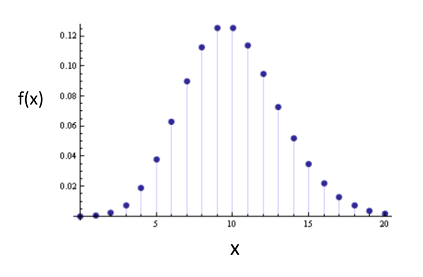

This is a template environment, pre-configured to run Github Classroom assessments.

# PCA y PPCA
## Instrucciones generales
- En su desarrollo considere el código de ética [ACM Code of Ethics](https://www.acm.org/code-of-ethics)
- Además:
    - escriba sus respuestas y discusión de resultados en el notebook de jupyter 9_Tarea.ipynb
    - guarde sus gráficos y/o respuestas escritas a mano en la carpeta `images` folder y las puede incorporar en el cuadernillo utilizando la instrucción:

    

